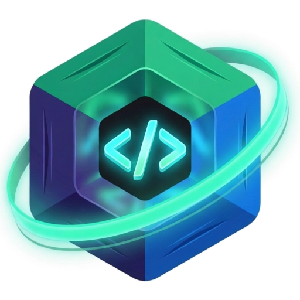

<div align="center">



# Compose Script

**Live Jetpack Compose inside any web page. No build, no server.**

Add one script, write Compose in your HTML, and it renders in the page, powered by
[Fast Compose](https://github.com/fast-compose/fast-compose).

[](https://www.npmjs.com/package/@fast-compose/compose-script)
[](https://www.jsdelivr.com/package/npm/@fast-compose/compose-script)
[](LICENSE)


https://github.com/user-attachments/assets/ea07289c-d29d-4f1e-982f-611f6590bdd1

</div>

---

## Quick start

Add the library to your page:

```html
<script src="https://cdn.jsdelivr.net/npm/@fast-compose/compose-script@0.3.0/compose-script.js"></script>
```

Then write Compose anywhere in the page:

```html
<script type="text/compose-content">
  var count by remember { mutableStateOf<Int>(0) }
  Button(onClick = { count++ }) { Text("Clicked $count times") }
</script>
```

[Try it live](https://fast-compose.github.io/try/#zhtml=XVBLb8IwDL73V3gRhyIE4Tyl0QTbgROTxmXHNDGio3kocdGqif9O1gwhzRf7k_09ZPH0ut8ePt_f4ES2l5W4N1RGVpBLJB27QJCibtiJKKRnzrVxq69ksO8uceWQuAuWvxxVoqX2NviE_K8vC_0fzGQmBS8g2_HiJ1pvRllVd08aAzaM8PvB194ROmIl3EVF0H5wBO0IES3aFiP8gB1ItT1-kCLcH8XOkazXc7hOpM1A5F3t3bbv9BmafD9pLBZwnWdwyH41m5ZoYFb0qbOY2K_EI3YeS-Ccf3rbDQ&mode=split), and edit the code beside the result.

## Examples

| Example | Shows |
|---|---|
| [Sound Wave](https://fast-compose.github.io/try/#zhtml=fVRtT9swEP7eX3Hkk8PaJH0BCVSqreVlTCAQRUz76CbXxptrW45p6ab9913e2gYYVpTYvueeu3uuveHB-d3k8cf9BaRuKUetYf1BnoxaQGt40OnAVD-rBL7zFZ4CV_SIJXeYwDd0hse_YKKXRmcIa0KAUGAkp_fXx9ubNqyFS7eAaWyFcQF0OhV7VlxAZuMzL3XOZKdhGCcq-JklKMXKBgpdqMwy_DznmevEJU9YfTul-6sjOXujYVgeqJiwrGY408lm1GoNY1QObZVA2h-9qqINFLgoIy-AvPvktJ-s2xg88xy-7ALHmiiV80rSfK24BGe5yoQTWsEZWFzicob2Ws2FEg4ft0Ym-QwlQbxcP89vcJiUk26zzR5ZUOl_KTV3bIvOV84suHzi8hmJMJq3G2bH7QJdbe3BIdxfB06XRH4TWwahcFODMaFFlfcDGuSOzyQyt0ZUrHsURW1Angm1INyNUMjtRXH0X3FuCy2q8ra2XckPet2s6FYnYi7QBimKRepYdxAFifEDw5OEIrBUW_Gb1Oc5b2-Q25oxd4AvliRcUBuUI-zeKcio_5iMN-z4rf8KrRMxeUuxULVvvQ8mxW_pqcLIza4k-NOgsYVslD4ZQEBn1LDW3Za4KgRijORjZe8_EfwQomBwNPfp0PUhhJ6_a9sborF-YW8u97V815ivYC0Sl7JuL5fh_6iqFaw3oHzKlA-h2438j91iKQx7yEcJJhNtFdppyg2Won_gN6M_58Lmfmxsn7M0qFtyZXkiqAFMiszdzdlES21Z9HJ52R-c909O_DbsrnpHx_2Lse-_E6l587fV3O1Pknp00LacJjQeion5Dw&mode=split) | An animated wave in a few lines of Compose |
| [Dino Game](https://fast-compose.github.io/try/#zhtml=1Vtbc9u2En73r9hoWpeKLUqiJNtNRU8dWY5zGsceyamTpw5MghIaiuAhIdtKmv9-BiDBK0hRaXo51INFEbvY_bAXYJcePzu_ntx-uJnCkq3c072x_IORfboHADAOrYD4DMLAMltLxvzwRbdr2Z7-e2hjlzwEuodZ1_NX3Z8dFLKORVc-DXE3_tuJyAu3-u9h63TcjW5O98bdaL7xPbU3p3t7ck628bHZYvgppbeox7DHWmAjhuLJ0L2LzdY58egrtMKtSO6fJ8kzce-sPZBDtDZ8Fj_y6wG5YBOPvgcThidO6fc7YrMlmGAonl1islgyMGFg5B8uArr27IuArl5SxuiKDxnmhzju5sxlhK1tDCaMjpy95HG3C3OGGA5fQGs2PTv_0DqE1uzd27ev377iX1-dXU1_u_51OmtlOAawQCss6OB-AwFe4dU9DuAzrNaMwyAeXTtazLINX3LUoUWDCsrXHpPEvSLZkiyW868jZcT6uDuV424uURWhpHKQG2JOmcX0DV0QC7nwyFe0u4zWTlv7NmLYBnvjoRV_7m7ACegKJsh7QCGE5BNu5yUg2LUjs1AKceFSlMg_OOo5JRU4g9h2tnPoxxyyqnBLBn-5CYkVgsZN8QOQEGKd0D19wLEN_gQ9B0ygXnyfVyWi3C5DWYcH7FKLsE1z6qz81_chQ5aLIeRDcowtZLF1-L4B26FRFiuibro4_aMKBo0XZ2CU1wZbNECMPGCwXLq2wachYYR6YX4i_qzfRM--Sk9ObTShNk4K8IvgQ611OMP_XeOQ4QDMLJOL3DMtP7MLHp0R3xc-igNkccXy9FeJD8vnc7oOLKzlpODxOPTRozcRgGshQwF7_wKE7Nn4zC9pEyZEw3IPuVAPKCDI45F4hjybrnQPP7HXHtMG7dzYxyX2QItHF2fhVw86p_A5Z0Ym9IfOT3nDMME4cjLAyKuvJD8pkw-U5NgNsYqDcaQQ4KTIIb0r4MwCsljg4D_rlX8dzDmCWlF34oCW5o9nZppvVChFucKEXulJFFBMwS-O1O1cqhMq9pwSYRpPCsQ9J6LpG_qwTJY1oUxcPoBRz2mXRqcaZhTMYxhNxiV4JjPN_n6s1tiEnj5yVIhkxS9LqlyZN2jtWUtsTx0HW0x755GSRbJgo5gr77x6EH0Tbqu1C9pYiFlL0H57AbfLgD5yxyxO0kS4ZDXKVlPxqAiKYsk5dQxs1kRUnCBjWpmhpXFfqhYzIj7l1rS_nxWMS7ZN9o6x-3ImplZk_rgkLs46m7nF2Wzsoo02MMrmLDZQByb098riIxdCH2MbTNBOdMOBg9hrn0NP7_WOR05btygOLHzGrmjItP4xN-0ypy1rXMRKsc6gXjw4gI-UucTTV4gt9ZB4mlCIC2hwL3sOgzIz9Zr-8UdGiNOKJU3lODDT4Vs06nCf__FErVXGgqvsqAhABT4NYSynjC_lFZPZsmNGJqBcUjnoIJdqxjVaVIbaQsodjg6hfzxq64yKZK61y5arkjreD0mppR2opY8Hj6HDA31CbEJOsoECRrlzys3TVyxwMo9RmMcozXPcc9SOIwz6ezBEnKkEVvil8GPVY84nGnKanrbamYOXGXFoAjIPCz7iQUGRS-Wp9g12-AYjOhQf8PGVQ2fxZkSOTQ_MnVq65FQs3EItZ2SXsTCpuRpqwaMBUh61dXc4sZJ6SQPyiXoMudcPOHCRH4sW8TvNyhLvBsT3cXZaJeMHHDB-qMyzjdUfSzeMN3UdGFRF4LKAIo3lmFfZV27Xo6gdyKvBblKu34S6lB8bxF-t93RxMRrwTzs38n5RHndxzD8ZLSfUXa88LTf3itrEIeJgchV_LUmrO8R1r9DTnHzCWjnC6PfI-hgdebVYDtUgGtg40Azd9g8zQp6f8Y8ibun5vZeWv60az3ddKhGpdxPgB4Iff8Gb6QP2GHwGLP52TitDgRig89IYDyqS8nbjY_0XvDmnjx7s71fmmJj8I97E1PrcRxa-RwHPoaWHU36IUz55u17dIFs8L2vGr7pkqDqQ1Axel2MbpFuB6mlEFahxHi3-olsusT6KtVMvRvGAC6bqcHxYQWwTC8WHZ2_tuqVRVfipzwSJyo3PBoniTc4IyeAKkRospwJgH9k28RZan_tfSlGcvNuFW-p3RMQVGS-EA7hwNyBOZy_XjFFe2w2wxdwNvPNsHHgYsWWOiSrMgDrUyMgikobWLi9gGozPXLLwVlhUHpLvuoCgTCbD9VkQIG-BJVl6p4fcF-2XG22YA0QFCr9u8RNT2yavmfNof_kavvuc7BR0Rucs4Ii3OfbRSo0O4YfeD-0vAPDd53DrsJbanq040CfJQT3MoR7jAZufkgd66FePupN1jovkRn9J3fKWQpEwX9InNSxN8oq8uPv72ownEGxPaODhYL5EPtaO-NpUh6ts4smdndL0YkyPzwdGOwpf6c_THv_UsU4iUk0E4JesXJggixi1w-tDSsJ059Air51CTEJU-bT6SRJRUg8FE05Edpfex4tvJe-CmoBb7WWQelpupVsX7uYFXL9tRSvMbyvcBjKuUzYW_W5JWFwy2-JYUHCufqVzwa4OJrDZulnM3Yo9RaCpYmvUopBOVIzzV4h4cEFcVxg579XBWYBRbpjSu5t6diG2q8c8RjL2HUXsjxuQ6sA_wTzvb43bUWdJCU9uU1tZb0EuuFEz647Xd3iLShddLeiCjb2QsE1a3XmDES_vnKgKogVulwm3uJNUzc6oYifMOD0cPzMTUdvZQ3P6cz2X-GiUsrls5_pn6e_lPCC1Cy3kYtE9yAKVClNP-EESJphk5q8kjTJAkbZT7gw_j2dRi9_twoTXHMLKiURJonzOOp_wj3qJ7AA9isQ245XKrYEpnaE6ojDqxyf1a8cJMUsqNLF67w9Fx0Qqq3AseYVRBBMeMBg6GQb9XiMGlsjVM2STdSggSW-1UZbfKMOuYdT7W9EzsugNd0dvaOTQ6__t6FVZ9CvhA-ASD8M-hFZAXZd4C_Dx_b2L1abOUX9DvIqzGDTfggqU-JY2RbvnHEp_rUEGe3ZKkkaSJqQhC-hHnHTzUuR2MDtRuhMAzX3ET43DihpxOnBC1yJBZeNxN8OEl2h5xbbNy2o1QZCvz3xJhIHKGr2onV7Q4JyEPu9PiJNDuw3fZ_hXbO4D0AgQD3q6npGzbj-YqsSjuKYReJ7FopOVkSuT6ssF2hLoQfp0rTtDxsLSKPvjlH9qVh5U3i1VSZ1JZouDnFvVs826-lHWM41tngmVRqYoGUOchUShMnlxozodFQq2UqxqglvKy6ISgU6-z13rKIL8LpksMvDtE14mFMVJvkW8Lx3zdgn74vaAKxV3Pw4FPg0DfkwmqC6_MsYPspY0-Fsy5J9GLAKJ43YpABioNu41gA0EYNHXUR1tHXDGTi747wAuNbVjpwii8f8AYlW0uu3M8BNMlogXYSuOgqKXket1bQ0ddjFWaZm3QKPu14f29phl38VTNoxY9mU8_q-IVw22SyXjsWPjse_keh8KbBpaTEx2JMhikzn5WpP5ZgGrEVpxK-nrsRoZMVb8p0h3ZZ1BhdtAz-3As7d_ZZj5BhZSVnowbKp1DriIeFhL_O-xlq9GrojWsHE0loAPU7QMo6JU84-plxrGcdkyhkc76to_SXXtV6paXfvCizOPrOYM-3EVVr5tMez12mBE9ddB9fmIYf-WLhYuTo5H3SzTdvICSCUL6sVHYjP_pmGNzA57gxeXscDql8n4KwIJ5_39jKDtBK5h_HalNBXFayFyzoDnnp0nfdZw1n_eFI2Tkike72yK3O3k4vxrnU6Rg75O08QkmqqqOF_u9uYx1LRy5bVLlw8KHTu5pZ4exS-qHIKiBXhS3wKEylZU_6jYi-r3OK9q6Lf1mqOWw2Uyyt1U8_pTDWh51dVp6ltlkG-XFeJH_E9JrZvZdD6H-c3ZZApdmL69nc7gega3ZzeynfYKzuAKpgBwDb_CFGY1zTXYzXOgpjk2fWIB4h2y7eSyCzfUQ3_HCgx8IxjPqb3AwJZYlDqIxO4mwGEY9ec4uuL1HhoAQz4wCgEWldGGeKbHz-MR_2ypV2WBMXYHZtsrO9n31SANNX5AHjg40f-bKGqWL-C1x9rxP57s-rZ0-j-Me-Nu9N-L4674H8r_AQ&mode=split) | A playable endless runner on a Canvas, with keyboard and tap controls, collisions and a high score |
| [Travel Explorer](https://fast-compose.github.io/try/#zhtml=7Vptc-I4Ev6eX6Ghtq7sWjAGAgmpJLeBbHazN1OzFWZnau-bsGXQRVheSYSQqfz3a8k22GCbl8zu3ofzB-KXbr083f10S8rlu9uPw0-___ojmqoZuz65TP8Q7F-fILgu3zUa6JPAT4ShH58jxgURFwijaMpD0pD0hfhIxZ-lJwgJ0YKqKQqJWnDxiOgMT4isg4KHBZ9LEMOhj2QkaDiBW_iuKA-lgxqNpENohkYKSeFd1aZKRfKi2fT80PmP9AmjT8KBtpthNGv-EGCpGh6fRVySZvK3EatvPIJy7fqyGT_A_JrxBC_H3F9en8B8O9e_EBVh7xENY0V0N2cMjcyUQLwDwsnA1DIiVzVFntedeDxUJFQ15GOFkxHhMQOxBLKf-YzEbdXiWWpB5DEsJbolUtHQwGCZb_p6wgxR_wLdh6qee6moYuQCjZQGMP-Jcc-0UvxVwLdwcoFu-RxGlv9mrPSbYMWaPolnvtW0fXKSkUknIdEVYlSqj8F6OoVz1Bf1QbpVz70zU4TXtX8tueLoJyx8EspaXiid7Equjn7BEQ43xOJZg9Cp089_SeesG0jdLPZWZx7KCEwzdcCSTXB0xRut036nf9ZzT93O2WnjvOudk1Y7cD2X_HNxde66__gDfjf6zuCmO4EgCv-YU4bGeDbmHE0Ef9KhMQWsuKAeklOAlsg4QIggIdGR5VPdAEA8iXFANfR9rht91WiI1JQgcGuhEA9iLJzMgOz6nsZolxjjZoZZQCE8IOgqbDHCjIgQrHGvMFuWW-P8Tdbodjott-ue9c_O3Ua_Pe6Pyel52z0729saN8gXWJOPhzw9JQbQa-AiuAeSCqic6qE-Ucb0KFBEhDcFrgNtOSVEQPDSICixBh6DaY1BPhCwHxFgenKkPTol9hgtKJDHDYuqIuPfRMAcVR2BtHohgoFvVURI941GcVvtNgRIu9dt4G7QCvotvzPu9_c2ykAQrKYKP-oRRQQ_yjibQCphfiOmS_lINQFB2BgpiBDK4pjx-MsSYRZpS3pT8EMlCxBPSOuH4YqlzXMwD9EWWVs2-pqhQgFhyYinwA3GSyTIjMzG4Alf0WyudEMjhRUB2suSoRNQIZVl2-g11xKVd_gJwl6R6rYCzCTRyjlKDhLdkQfT1A3EmZTcMY7VjTTKeV9SWEyI-ozZXHsPDZC1HoGNWk4nQAR6Qq0gb6FVih5FxAPNOHNbWz7v4xkAP3nQsiA2MmLObeatDoX5bMDnobesb-kDYkEA7CfXyqP01Xu-yCvYGx6Px8Q4aQ6WrOlz4EFsQiAshxyMncHOPO-BnZFzBgyKBfD-aGmBy01xAmrqII6OXchsNnKdswRa1-kFdjW6aqG9zp8L8_IDkA_VgPRct2zK2cnkZry6HfDn_HQ-cJ8GlIgtGzi6nLMW1IeQA-Lpu44fQaAROpkqeHHW1i_sbTWgwsh6AMP6xB9yERIxmuKIWJ22ll8rZKNJX80mGgCKkAhBNWab3PcbuQy9e_16299m3DcArAFPyGrbtZLq7DbHNSs9Q6ilSnGAaaOvH52h4FG9aEQGVpBOEYbgZ-wDfh5pXDcsmLFQgsVPOtlDJygAvwQm9DUPIF1o5iS37FlpU2Og3DCKRcYrQ1iFAqZnMQfGB4eDrIlZOtxyeeOocSVYGjQuMI9dT4JKl0gywlD6QMrKerZd2kfxF3sH1J94BGVYHq0HvjgS1y86YsqAjbDva8acAjO9gBdh7bXtOLRSKHUN3NOxsu1Va7UbXUVMIFGEOhgzT84IFi5kQAx5bLeQdnLD6CRMtdN7Zwg_RHxOZNgGM29GrL5GcxFAf8VmlzrwdbxQ4UES00_1QkHPsG_Kpl-mwNqbjtHuBnaxclGoGe46PS1GsWge-rqHMB_MlYLKi4dDRmH9d4W-vpaJpyqW_pHOLQnwnCnnfVJxfQzrxWRTSyVqdSjgjAUy8y52nNeT3W_-N01RCl3WRhVCmmOtXCp_s0Wz5dYVepd52m3rSnozWeczZBKD4GZZlXeTVZ-mGij-NuCwyBP1yj6LXSxtoVatnLjf5khj2z9AZWsGl3GF-oHUu8tvX7fI-JYoXcPX81tEY2PEnCyMaj4L_wySxpoPrTUrDjh0Pou5cQevj42o5vRtvy7yrZu42vQ_U0nHlFG1LPawJ_3d1B5KzEusYMYHEgH2yX1oFVeTXSgebfQ9koxqqTXVWzSkimL2EdaxRP0ex4lCTdSGqNg_4hKrrIi4OOEZcKpirTD9fqs8dkxWlTqr-oOlVZJTduGyP4mkUms6gEXIDhIoJ4IHs6Cv7VbPZiLLfb6Da9hyz-zdmqX5t3VejVU5baTXJyh3d6Oli2I91---rur4eB_jtbYPbFv5brdSAFh_SVdCd6sHYArm76etq29d6J2CZx2L0GvpF1MDinUUxqs2q5dfgR2OdoL0ruXSm_DNoANLxl3oHGcJ-__Esw_xZErZ4-gnnDN2GPUUV5znwZt4qPeX8tAqOtK916NI6CgI_jZmabW_NbVkNoMPJphN7Pq7sDsMN3068HPKObB43yU_w8_vzVnO1v79cQX0yZ5GScqsbfn3-GVZSnRJIP8aF24w5uTO7HjKokKueE4HkVtZiJaxGhh5JnNb63X0SJZJ1ar3W_VSzoih5Ci56Moctgyx8Ks9NNObXjNB09Vmp3KUHhDE4sk2cGZXuLoBKN2NqJmVzLeFXv9ST3JLPClZXJ8UD3-9h_INtgv2WLkZuWTI3V71xkLFwqReuYNSsLVdlWAMPenQj6FKUqt04hWtIS1p6ZjDQBFiuE1mB0RFNcumZXJysKUPuIigJPSqdgny7Gq2bMuFszTaq6TFw8u2YlNu-qs5rrDOy5NRwYYdEBJf3HGxAAYo27JLMNvcsTN42Dv3OPJ3r-Vnjpt8lKGci-zHeoZcLtCAc0YwvEwJ4wJZNtAe-g2W9PlDS4bGZk_JRFHmuOs22vucMO3XRh2AOT3M8qO9TgqrDvbiI8Gyo63MuAvP8o492Gq5mwdbB55rtUq8LXuIsolcJryzW2yZE4_iAXiP2l0ye5mpxQvE11tSK-AOmVWv-rRun9O4jPceeiCXVf37zuQ243b9P2NwG_-32GUz_ie5_wI&mode=split) | A phone-sized screen with network images, a carousel and spring animations |
| [Live Showcase](https://fast-compose.github.io/try/#zhtml=rVptb9s4Ev6eX8HqFgtpV5Zf4nVTNwmaxMk2h7Yp6twWi8OhoCXK4oaWdCId2xvkv9-Q1JutF7u5qkBlS8PhzHDmeYZ0Tl9N7q7u__x8jQKxYOdHp9mNYO_8CMF1-qrTQdMgWrmYkzHCIV1gQaPQRlxgQWyEEV9gxpDA_AHhOAYRD737nJBHSlY2oiGKGYb_399__IBWVAToKlrEESdo6iY0Fg7qdNKpuHqAeOKeGYEQMR93u64XOn9xjzD6mDghEd0wXnTf-ZiLjqv1dNN7Rw_f-QqDjfPTrv4CnnW1a6ezyNucH2lPSbJtgNjE5MwQZF0oc6NQkFAYyMMCpzPjGQOxu2RGhaEVyOvdVf4yf-YvQ6TkTAs95U_l9YghcgkOOZVBRWcoIQuymJHkNvRpSAW5z1-aDM8IAxEjUlNaFUU4nDOCZpuSRkcvGLlhERbm1gh5ySkoZn9gtiSguefbFRGBkzkRmcTxqE4mz4ppTFyQoqnxX0hMIF4QClOsCAnNUa_XsxHBnIZzkPtAQ4KTa_XVsqp6c4-VZ8bW-233r3D4iLn5MfKoT0nicPo3MfsnPceLrd2YZ-FKsEeXHNRLYWdBwwldEIgbrEMXDVAH9Qcw3BHR57VpVTR0u-g-IEitBdQFEgEkeQKO2MhL8CpEmMNTlyYurInKewHiMZ4T5EYsSiBInHrEqSiWo6_UMFMLnkHFwN3srUej4-Hk-M0byy6MTz_8ikrGWt-j9Oamd9N_PbioUdo5WGnlnbxmyZIHoO1S3h2pE7Pf5Q0qyWSUizvfLKzIXSseDX4bHV9fWnWpIa9dc39BPWf4m1-RrVqeqMQ0jyE1EEWd81r1WY5ALcEcpq6uX0H-F8iMngW3z7eQKZBltcP3RUde1bXIotA4JHf6pFiaZmkXQk3kDHe-z4lotqQQdtbgpBtxM_Xdgkk0fEiX9fT2IXo2oAcqu01Poxrr6LCnz0f13_SnAvfVt6B__k8iYuw-ZBxkI-AVglJ6AnLop6Lx-fUjSTbIxYmHAISiFaIc0gZSIqMvN_JIWsRQ6D8z8VZP9vNcvAXUnDvoU4RmS8o8G4UR4iQBjc5pN85YSNLO0ekCyDGjH-IqFnAZ5vzMkHOXiOU0GJxPJecqhs0hF3QNSkLx-STBc4U1nIFpiY18RmP9AGDIDbQJ-YD9nHe-QzQJ4i7WRJOxFZTRYqmAXlkIdd1zRr61szxyaBItwfrWoSJZkupQBgFPQpCHsSmpTeILrgaZ1Eem0myhkcR8RBiskMJvu2ARraCGOHUZFopVOWa6q6RZTFapWz1x8Xh0PBrd9NuoTc3dSm0RWy7CgtpW1BOBOVB-AloGUUL_hpXC7ILReQgMJkBt_tm5UsX4Ppdimzo-vIzWu-Q5TCdI06BNe53GTGtjiWfTtUKJtsUc9iSWqKwD8O31LGla-0AXst78IpeJeFdq4acBjiX9yc_WntEzAIm5WmTNly_DI3lNVRWaj2kDpZywURSqjuoqAFaRj59S76B3Eui5qvdLtDIBPgR129f5j1SmfpWVPQoETDcg7gPxJHlKL6VFV_pRySZdrE02KW2ApuDdTnKeqLardsA9IEy5XA21RIauG2P63yVOiHE4zu8gfDeFUADWAxH1QoM6o0JA-GH_UsHTCw-io8KlgBe2IgQwWG53-HdDaXX7cC_17ECsFNImI_naVJsECvaN0VToFlM-8qIQnlxGESNYbh18DDG0jrZU1e1Gsh2Jmtps6o6Vg6UNSUM6lbH7g27pGitLOWN8TWBnkLNoSr1GSw-jh00fUhZTlGrYyn2wT7HF3sEBpFXegBsvr2ZJYXJl2xnMMKzasSw3WmWPC6kvZAcqHPW8OqQe-497jfuavMSMn5TKyEc_PenZJJI-KwMgeD4k5FdC54EEkZv8i3MZMa8-Onqv9jmJ5gnh_Db0AGYEsFxj5ONUVCGJrHhtBuXXi1hsYD8B201d9tKmUnPYRYXB6Ll5aRdpVGCCPEA-ZewjXn9VcbKcGHse1EsOnWnbfOj6_1jkldfdUjAIpCfX6IYS5rV35BlryJRr77mrhKLSVGN3-9CsFXlKM-cTWakVkEncPlLu2xmRmZEWYrt43YKtVN6Zfd_6zr2AvG4BVy-XQkShCfTFKED0WUvws-ZNRgby8FMkLhkOH0zL2jNIn4PInIR8MhWkKB0AxgsYbe0frNfCMFolnxvfPu-zUEbClP9xZ0J8vGTC0byliWdCNDfpMyYDXhnNRtebUf9UR8WPkmvsBgAKZA09BZS7rc8DG3bWP76uFFhKjp5By1n0NtIIha31_Y2y_t_0P5mkG8UbM4VoKqympmcLaA9KHEfRt71Xtr1C7IPybEKgxcXpUme4q4JgKYuL946s3PsAOrF5oJE4XDLWOom1Nwur9ZgmCdBl9EguoPuz9udzQ05PVPPVlNb6rWG9tMgOzPsf14si4HOy05AWR-dM0bPqOXHyUOlL70J5BpF1dzYi6sAi1qMRD6JViNThBLQq6q4OIangiBMhALkPb19TpQbiYiOb1kCl5BgdH_fi9U7z2tZxQvcABE0aes4EPJZl29pa6Sa3rlWCeBaNUkb8_ZGk--09c1PuSURqUAAN9w-DqtZNcXljrPe-Q9Ww6O2sPk5U-9j9nFPew-oTWKZauJedwO4BnwMOCZr5fQ8W6K7k5sqwt89Lna8BlWDw_b1sOw7U72nVYVIL1Vda9Ry2D_QPc5HtioyXOlWoy_ZXsuijpZA_RcATKL7EsHUZS46BmkooZvcB1JsDhQ8dO46DjSN_HZvKn_VeEr8GFtDFfYZe6Q-HtTQHkUTBDzf4MZLby_1MWc8gH8A04wCapSrDJbkqZ8oHgdc3Q7jKB4EOVNzmhaz6Uk7ahuSUUswQL4h2E1JJ5gGQxGWOEtlm-mA4V2raMD1_913WTYDtwLgl_ShP2GWxhz6dL9Oe5V-33z7eTa6_fbr9_f39tz-vp_-3G3K-l3ixl_dPu_pw_-joVFWcFpC1VZplgZM5Dceo9zZ_lHIP8OsgXqP-KF4X7yQudHy8oGwzRnzDBVl0ltBucxzyDodq9gvZggDG6B89v_96gIuXCkrhORmQEz-dPF0Z_eOEjaT1W5auOwoLx-jNqFc2KvcB4aWIanSVtMjGooMlN4zTH4rq5OPSiMzSN0N8PDvZkt6x0KM8ZhgCM0-oV5gnv3UgUPBOyLM4CdR8nP0IKE3u-FSAvzQEH-XxSry2Ud9PLKukBMdjNMjdTg1wVBv3VB9y_8THvlsN-e5SzKIEfO7on8TKk2wlw_bjPWHUdgWDukSDf8NKSsleY4z6J7X-xQ1q-oOynsy90fD18GRWr3-4q192wCXtaqn0CoE06qJOf0t-50C11q5KDu60seXl2o78tj-wW0l8Fq3GKKCeR8JMJ1S4rmb4pP-MBHpz9Xcz_wM&mode=split) | Animation, state, a small task app and `@Preview` in light and dark |

## Script types

| Type | Shows | Size |
|---|---|---|
| `text/compose-content` | One composable, with no labels or frames | Set by the composable |
| `text/compose-preview` | Every `@Preview` function, with labels and frames | 400 px tall by default, or set by CSS |

Each script is replaced by a `<compose-content>` or `<compose-preview>` element with the script's `id`, `class` and
`style`, so pages can style them with CSS. Parse and runtime errors appear inside the element, and each one starts
when it scrolls into view.

While the `.wasm` files download, each element shows a soft loading animation, 160 × 48 px for `compose-content`
unless the script's `style` sets a size. Pages can restyle it with the `[data-loading]` attribute, e.g.
`compose-content[data-loading] { background: #eee; }`.

## compose-content

### Body of a composable

By default the code is the body of a composable: write the UI directly.

```html
<script type="text/compose-content">
  Column(Modifier.padding(16.dp)) {
      Text("Hello from Compose!")
      Button(onClick = {}) { Text("Click me") }
  }
</script>
```

To declare your own composables or classes, use `data-composable`.

### Whole file with `data-composable`

With `data-composable`, the code is a whole Kotlin file and the attribute names the function to show. The function
must be a top-level `@Composable` function without parameters; the file may declare other functions and classes.

```html
<script type="text/compose-content" data-composable="Profile">
  data class User(val name: String, val role: String)

  @Composable
  fun UserRow(user: User) {
      Column(Modifier.padding(8.dp)) {
          Text(user.name)
          Text(user.role, color = Color.Gray)
      }
  }

  @Composable
  fun Profile() {
      Column {
          UserRow(User("Ada", "Engineer"))
          UserRow(User("Grace", "Admiral"))
      }
  }
</script>
```

### Size

The composable sets the element's width and height, up to the width of its parent and the height of the window.
Content that fills or scrolls needs a size in the code, e.g. `Modifier.height(300.dp)`.

A `width` or `height` in the script's `style` attribute is kept, in any CSS unit, and the composable is measured
within it; content larger than a fixed size is cut off. The composable still sets the side that is not given.

```html
<script type="text/compose-content" style="width: 200px">
  Text("Wraps within 200 px, and the composable sets the height")
</script>
```

Sizes from stylesheets or classes are not read; to size by class, put the script in an element with that class.

### Layout

The element sits in the text flow like an image (`display: inline-block`), so other elements can go beside it. For
its own line, add `display: block` to the script's `style`.

```html
<script type="text/compose-content">
  Button(onClick = {}) { Text("Click me") }
</script>
<label>Beside the button</label>
```

## compose-preview

The code is a whole Kotlin file. Every `@Composable` function with `@Preview` is shown with its name, size, background,
font scale and night mode.

```html
<script type="text/compose-preview" style="height: 300px">
  @Preview(name = "Light", showBackground = true)
  @Composable
  fun LightGreeting() {
      Text("Hello", Modifier.padding(16.dp))
  }

  @Preview(name = "Dark", uiMode = Configuration.UI_MODE_NIGHT_YES, showBackground = true)
  @Composable
  fun DarkGreeting() {
      Text("Hello", Modifier.padding(16.dp))
  }
</script>
```

The element is 400 px tall by default; set another height with CSS. Previews taller than the element scroll inside it.

## License

[Apache 2.0](LICENSE)
